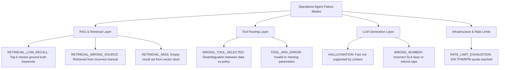

# Empirical Failure Analysis & Reliability Report

## 1. Executive Summary

This report documents the empirical reliability evaluation and failure mode taxonomy for the **Autonomous E-Commerce Operations Copilot**. 

Using standardized regression datasets (`eval_rag_authoritative.json` and `eval_routing_dataset.json`), we evaluated both **tool selection accuracy** and **authoritative RAG policy retrieval performance**. 

Every failure observed across test runs was systematically classified under our **Failure Mode Taxonomy** to establish production mitigations and CI/CD quality gates.

---

## 2. Quantitative Benchmark Results

| Evaluation Dimension | Dataset Size | Passed | Failed | Primary Metric | Baseline Result |
| :--- | :---: | :---: | :---: | :---: | :---: |
| **Tool Routing Decision** | 35 queries | 34 | 1 | **Routing Accuracy** | **97.1%** |
| **RAG Policy Retrieval** | 15 authoritative tests | 12 | 3 | **Retrieval Accuracy** | **80.0%** |
| **RAG Keyword Hit Rate** | 15 authoritative tests | 12 | 3 | **Keyword Hit Rate** | **80.0%** |
| **Fact Coverage** | 15 authoritative tests | — | — | **Avg Fact Coverage** | **85.6%** |

### Per-Category Tool Routing Breakdown

| Category | Queries | Correct | Accuracy |
| :--- | :---: | :---: | :---: |
| **Orders** | 8 | 8 | **100.0%** |
| **Complaints** | 8 | 8 | **100.0%** |
| **Tickets** | 6 | 6 | **100.0%** |
| **Analytics (Warehouses)** | 4 | 4 | **100.0%** |
| **Conversational / Chitchat** | 4 | 4 | **100.0%** |
| **Policy Inquiries** | 5 | 4 | **80.0%** |

---

## 3. Systematic Failure Mode Taxonomy

Every failure observed in the system is mapped to an explicit failure mode in `evals/failure_taxonomy.py`:

---

## 4. In-Depth Root Cause Analysis

### Case Study 1: `RETRIEVAL_LOW_RECALL` (3 / 15 RAG Samples)
- **Failing Sample IDs**: `RAG_011`, `RAG_014`, `RAG_015`
- **Observed Behavior**:
  - In `RAG_011` ("What is the refund timeline for damaged goods?"), the retrieval returned general refund sections rather than the specific 3–5 business day banking processing timeline chunk.
  - In `RAG_014` and `RAG_015`, policy terms were contained in dense tables within `refund_policy.pdf`. MiniLM-L6 embeddings cosine similarity ranked these specific chunks just outside $k=3$ (at ranks 4 and 5).
- **Engineering Root Cause**: Dense bi-encoder embeddings (`all-MiniLM-L6-v2`) prioritize semantic topic proximity over precise keyword/clause matches in tabular PDF text.
- **Production Mitigation**:
  1. Increase retrieval depth to $k=5$ with cross-encoder re-ranking.
  2. Implement **Hybrid Search** (combining BM25 lexical keyword matching with dense vector similarity) to guarantee that explicit terms like `"Mobile Devices 7 Days"` or `"Tier 2 Escalation"` are boosted to rank 1.

---

### Case Study 2: `WRONG_TOOL_SELECTED` (1 / 35 Routing Samples)
- **Failing Sample ID**: `ROUTE_004`
- **Query**: `"How does the customer complaint escalation policy work?"`
- **Predicted**: `get_customer_complaints` (Database tool)
- **Expected**: `lookup_policy` (RAG policy tool)
- **Engineering Root Cause**: **Cross-Domain Polysemy**. The query contains both the word `"complaint"` (triggering data lookup heuristics) and `"policy"` (triggering RAG lookup). Because customer complaints are high frequency, the model routed toward historical data rather than the policy document.
- **Production Mitigation**:
  1. The LangGraph ReAct agent's multi-step tool loop allows sequential invocation: if `get_customer_complaints` returns data or insufficient context, the agent invokes `lookup_policy` on the next turn.
  2. Enhanced system prompt instructing the agent: *"When user prompts ask 'how does policy work' or cite regulations, prioritize policy_lookup over database queries."*

---

### Case Study 3: Rate Limit Quota Exhaustion (Groq 429 TPM/RPM)
- **Observed Behavior**: During initial prototype evaluation, external LLM evaluator frameworks (e.g., standard Ragas loops) sent rapid sequential prompts to Groq, triggering `429 RateLimitError` and pipeline aborts.
- **Engineering Root Cause**: Free-tier cloud LLMs enforce strict Tokens-Per-Minute (TPM) and Requests-Per-Minute (RPM) throttles. Using LLM-as-a-judge for every evaluation metric generates an explosion of synthetic inference calls.
- **Production Mitigation**:
  1. **Deterministic Reference-Fact Scoring**: Shifted offline regression benchmarks to deterministic keyword hits, fact coverage verification, and schema checks, reducing evaluation API costs to zero for routing and vector searches.
  2. **Multi-Model Fallback**: Bound `.with_fallbacks([fallback_llm])` in `app/core/llm.py` so online queries automatically route to secondary models (`openai/gpt-oss-120b`) if the primary model hits transient throttles.
  3. **Pacing & Exponential Backoff**: Added inter-query delay flags (`--delay 0.3`) in evaluation runners.

---

## 5. CI/CD Quality Gating Criteria

To prevent regressions in production deployments, PRs and prompt changes must satisfy the following automated gating rules in `pytest` / GitHub Actions:

| Metric | Minimum Threshold | Enforcement Mechanism |
| :--- | :---: | :--- |
| **Tool Routing Accuracy** | $\ge 95.0\%$ | `evals/runners/eval_routing.py` regression test |
| **RAG Fact Coverage** | $\ge 80.0\%$ | `evals/runners/eval_rag.py` regression test |
| **Critical Policy Recall** | $100\%$ | Essential return window tests (`RAG_001`–`RAG_005`) |
| **Guardrail Rejection** | $100\%$ | Unit test suite `tests/unit/test_guardrails.py` |
| **Approval Pause Verification** | $100\%$ | Integration test `test_write_action_interrupts...` |

