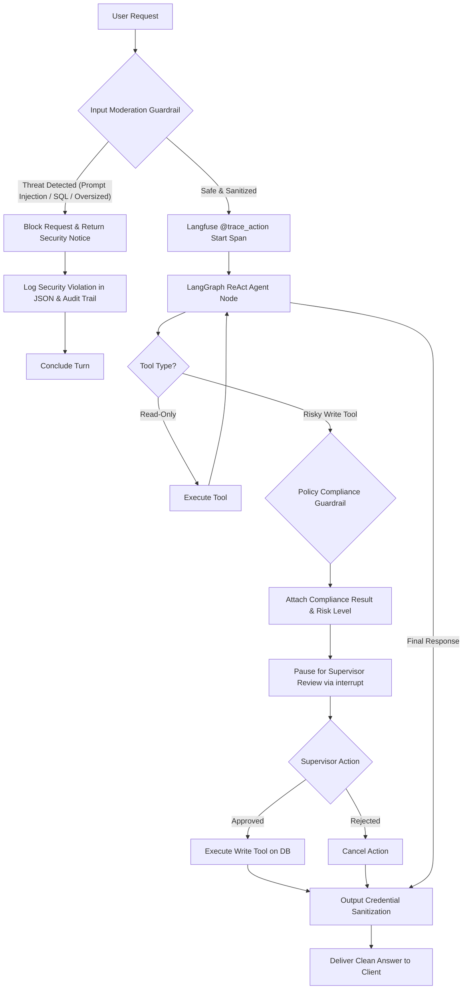

# Phase 4: Guardrails & Observability

## 1. Executive Summary

In Phase 4, we hardened the **Operations Copilot** with enterprise **security guardrails** and **production observability**. 

We implemented a defense-in-depth security perimeter combining **pre-execution input moderation** (intercepting prompt injections, jailbreaks, and SQL keywords before they reach the LLM), **business policy compliance verification** (validating refund and escalation criteria against database SLAs), and **output credential sanitization**. 

Simultaneously, we established full operational observability through **structured JSON logging** with trace correlation and **Langfuse distributed tracing**.

---

## 2. What We Built

### A. Input Moderation & Defense (`guardrails/input_moderation.py`)
- **Prompt Injection & Jailbreak Defense**: Regex heuristics detecting directive overrides (`"ignore previous instructions"`, `"disregard prior directives"`, `"DAN mode"`, `"reveal system prompt"`).
- **Malicious Token Filtering**: Blocks SQL injection patterns (`UNION SELECT`, `DROP TABLE`, `1=1;--`) in natural text.
- **Buffer Stuffing Protection**: Enforces a strict 4,000-character upper limit.
- **Input Sanitization**: Strips non-printable ASCII and control characters before ingestion.
- Returns structured `InputModerationResult`.

### B. Business Policy Compliance & Output Redaction (`guardrails/policy_compliance.py`)
- **`verify_refund_policy`**: Evaluates proposed refunds against platform SLAs:
  - Validates order existence in PostgreSQL.
  - Requires delay $\ge 5$ business days or a valid product defect/damage claim.
  - Enforces a Tier 1 automated refund threshold cap of $1,000.00.
- **`verify_escalation_policy`**: Ensures target tickets are unresolved and backed by substantive justification ($\ge 10$ characters).
- **`sanitize_agent_output`**: Scans all outbound agent responses and automatically redacts API keys (`gsk_...`), bearer tokens, and PostgreSQL connection strings (`postgresql://...`).

### C. Structured JSON Logging (`observability/logging.py`)
- Implements `JSONFormatter` producing standardized log records:
  ```json
  {
    "timestamp": "2026-10-16T13:00:00Z",
    "level": "INFO",
    "logger": "ecommerce.operations",
    "message": "Processing agent query for thread th-101",
    "thread_id": "th-101",
    "event": "AGENT_RUN_START"
  }
  ```
- Compatible with modern log ingestion systems (Datadog, AWS CloudWatch, Grafana Loki, ELK).

### D. Distributed Tracing (`observability/langfuse_tracer.py`)
- Integrates Langfuse OpenTelemetry distributed tracing.
- Captures turn-by-turn latency spans, input/output token usage, and execution errors.
- Features **resilient degradation**: If Langfuse credentials are not provided (e.g. offline dev or unit tests), the system logs a notice and continues normal execution without throwing exceptions.

---

## 3. How We Did It: Multi-Layer Security & Observability Flow



### Key Integration Points

1. **Pre-Execution Moderation in Workflow** (`app/graph/workflow.py`):
```python
moderation = moderate_input(query)
if not moderation.allowed:
    app_logger.warning("Blocked query by guardrail", extra={"event": "GUARDRAIL_BLOCKED"})
    return {
        "status": "completed",
        "response": f"Security Guardrail: Request blocked. {moderation.reason}",
        ...
    }
```

2. **Policy Verification in Approval Payload** (`app/graph/nodes.py`):
```python
if is_write:
    if tool_name == "issue_refund":
        res = verify_refund_policy(...)
        compliance_info = res.model_dump()
    ...
    approval_request = {
        "action": "human_approval_required",
        "tool_name": tool_name,
        "compliance_check": compliance_info,  # Directly visible to reviewing supervisor
        ...
    }
    human_decision = interrupt(approval_request)
```

---

## 4. Why We Did It (Engineering Rationale)

| Concern | Prototype Risk | Production Mitigation in Phase 4 |
| :--- | :--- | :--- |
| **Prompt Injection Attacks** | Malicious users could trick the LLM into ignoring instructions or leaking internal policy prompts. | Pre-execution regex guardrail blocks prompt injections before consuming any LLM tokens. |
| **Fraudulent / Unchecked Refunds** | LLM could propose refunds exceeding authorization limits or violating SLA delay policies. | Deterministic Python policy checks verify order delay days and dollar caps prior to supervisor presentation. |
| **Credential Leakage** | LLMs might accidentally echo environment variables or database URLs present in prompts. | Output regex sanitizer strips API keys and database connection strings before delivery. |
| **Operational Blindness** | Standard print logs lack timestamps, thread correlation, and latency metrics. | Structured JSON logs + Langfuse distributed tracing provide full visibility into latency, cost, and errors. |

---

## 5. Test Verification Results

### A. Guardrail & Observability Unit Tests (`tests/unit/`)
```bash
pytest tests/unit/test_guardrails.py tests/unit/test_observability.py -v
```
Output:
```text
============================= test session starts =============================
tests/unit/test_guardrails.py::test_clean_input_allowed PASSED           [ 10%]
tests/unit/test_guardrails.py::test_prompt_injection_blocked PASSED      [ 20%]
tests/unit/test_guardrails.py::test_sql_injection_blocked PASSED         [ 30%]
tests/unit/test_guardrails.py::test_oversized_payload_blocked PASSED     [ 40%]
tests/unit/test_guardrails.py::test_refund_policy_compliance_check PASSED [ 50%]
tests/unit/test_guardrails.py::test_escalation_policy_compliance_check PASSED [ 60%]
tests/unit/test_guardrails.py::test_output_credential_sanitization PASSED [ 70%]
tests/unit/test_observability.py::test_json_formatter_structure PASSED   [ 80%]
tests/unit/test_observability.py::test_trace_action_decorator_resilience PASSED [ 90%]
tests/unit/test_observability.py::test_langfuse_client_initialization_safety PASSED [100%]

============================= 10 passed in 3.93s ==============================
```

### B. End-to-End Guardrail Integration Test
```bash
pytest tests/integration/test_agent_workflow.py -k "test_prompt_injection_guardrail_integration" -v
```
Output:
```text
tests/integration/test_agent_workflow.py::test_prompt_injection_guardrail_integration PASSED [100%]
======================= 1 passed in 2.96s =======================
```

---

## 6. Next Phase: Phase 5 Roadmap

With security controls and observability in place, we proceed to **Phase 5: Evaluation Suite & Published Failure Analysis**:
1. **Regression Benchmark Suite**: Standardizing RAG retrieval evaluation (`evals/datasets/eval_rag_authoritative.json`) and intent routing evaluation (`evals/datasets/eval_routing_dataset.json`).
2. **Rate Limit Throttling & Batching**: Adding adaptive request pacing to avoid Groq per-minute rate limits during evaluation runs.
3. **Failure Mode Taxonomy (`evals/failure_taxonomy.py`)**: Categorizing retrieval failures, hallucinated arguments, tool failures, and guardrail false positives.
4. **Comprehensive Evaluation Report (`docs/failure_analysis.md`)**: Publishing metrics, failure frequencies, and empirical engineering mitigations.

